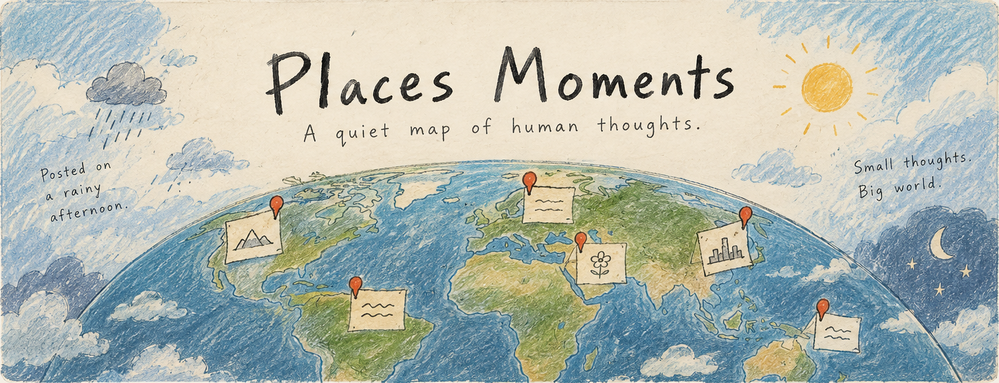

  

<h1 align="center">Places Moments</h1>

  <em>A quiet map of human thoughts.</em>

  A memory of a street. A feeling carried far from home. 
  A few words left somewhere they belong.

  <a href="#a-little-of-you-left-somewhere">The experience</a> &nbsp;·&nbsp;
  <a href="#a-quiet-corner-of-the-world">The spirit</a> &nbsp;·&nbsp;
  <a href="#beneath-the-map">The craft</a> &nbsp;·&nbsp;
  <a href="contexts/roadmap.md">The road ahead</a>

---

## A little of you, left somewhere

Places Moments is an anonymous map where people leave small thoughts tied to places around the world. Wander through words left by others, or choose a place that means something to you and leave a moment of your own.

| 🌍 Wander | 📍 Leave a thought | 🌦 Pause a little |
| :--- | :--- | :--- |
| Move across the map and discover words scattered around the world. | Choose a place, write a few honest lines, and let them find their place on the map. | Open a moment and sit with its words and the weather around it. |

> “I used to take this road home. Today, the rain brought it all back.”
>
> *Posted in a gentle drizzle.*

Public moments carry words, a place, and a little weather. Names and exact timestamps stay out of the public view.

## A quiet corner of the world

A small observation, a memory, words you never said. Joy, longing, grief, and hard days all belong here. There is room for more than one kind of feeling.

- **Anonymous by design.** No sign-up. A UUID stored in your browser connects your thoughts to the same browser. Clearing that storage or changing devices starts a new identity.
- **Space to simply be.** No likes, comments, followers, feeds, or popularity counts.
- **Atmosphere in the details.** Weather lends each thought a little context; gentle motion helps it settle into the map.
- **Words left with care.** Thoughts are public. Keep personal details private, speak from your own experience, and leave room for the person who finds them.

## Beneath the map

The experience begins with a 2D map. English and Vietnamese copy, soft transitions, and a small writing flow keep the focus on the moment.

<strong>A look at the tools</strong>

| Part | Built with |
| :--- | :--- |
| Application | Next.js · React · TypeScript |
| Map | MapLibre GL |
| Data | PostgreSQL · Prisma |
| Local state | Zustand |
| Motion | Framer Motion · GSAP |
| Languages | next-intl · English & Vietnamese |

<strong>Notes from the project</strong>

- [Product & philosophy](contexts/project.md) — the experience and the ideas behind it.
- [Architecture](contexts/architecture.md) — how the map, data, and application fit together.
- [Roadmap](contexts/roadmap.md) — the planned phases of the project.

## Still unfolding

Places Moments is in early development, with map exploration, thought submission, and weather atmosphere at its heart. The roadmap makes room for personal history, letters to your future self, subtle realtime arrivals, and a secondary globe view as the project grows.

---

  <em>Small thoughts. Big world.</em> 
  Leave a little of yourself somewhere.

